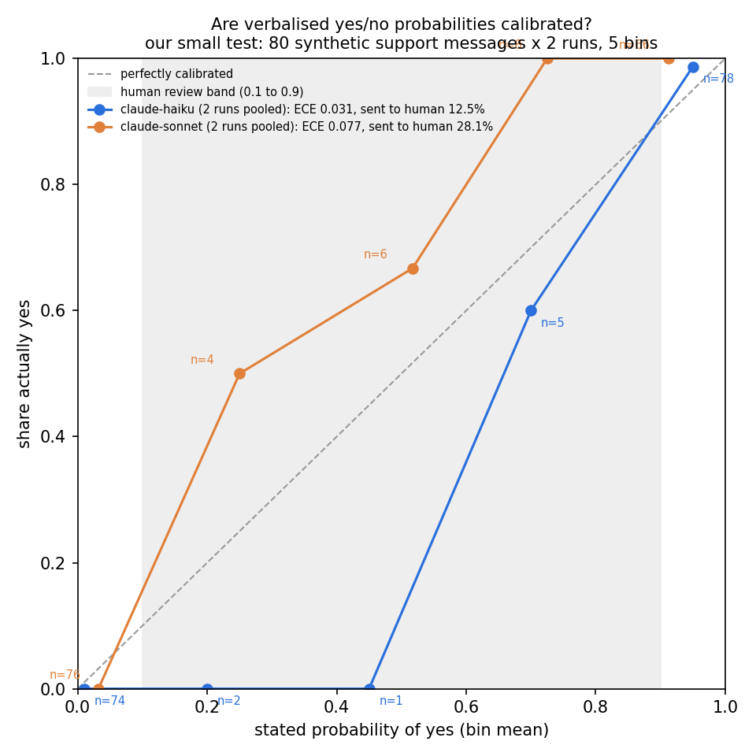

# Are yes/no probabilities from an LLM calibrated? (13 Nov 2026)

## What launched
Google launched the **Gemini Decisions API** with a new model, `gemini-decision-1`, on 11 Nov 2026.

- **What it does:** it answers closed questions (yes/no, multiple choice, rubric scores) in one forward pass and returns
  probabilities instead of text.
- **What Google claims:** the post calls the decisions "calibrated" and says the model has "the lowest calibration
  error" on its own benchmark suite.
- **Sources:**
  - Official: [blog.google, Gemini Decisions API](https://blog.google/innovation-and-ai/technology/developers-tools/gemini-decisions-api/)
  - Independent: [Simon Willison, 11 Nov 2026](https://simonwillison.net/2026/Nov/11/gemini-decisions-api/). He
    ran one video with four yes/no questions and saw scores like 0.92 and 0.05 rather than 1.0 and 0.0. He did not test
    calibration.

## What I tried
"Calibrated" is the claim that matters if you want to auto-approve above a threshold and send the rest to a person.
I don't have a Gemini API key on this machine yet, so tonight's run does two things:

1. **A small harness.** It has a labelled yes/no set, a scorer, and an evaluation that reports accuracy, Brier score,
   ECE and how many items an auto-decide band (p ≤ 0.1 or p ≥ 0.9) would leave for a human. A reliability chart comes out too.
2. **A baseline to compare against.** It's the thing you'd do without a decision API: ask a chat model to write its
   probability as a number. I used Claude Haiku 4.5 and Claude Sonnet 5.5 through `claude -p`, and ran each twice.

**The task:** 80 synthetic messages to a made-up payments app's support desk. The question is "is the customer asking
for money back or contesting a charge, stated or clearly implied?" Half the messages are deliberately hard: implied
disputes, and "refund" or "charge" wording that isn't a request. The label rule is in [data/LABELS.md](data/LABELS.md).

`score_gemini.py` is the Gemini adapter, written from the request example in the launch post. **It has not been run
yet.**

## Results (our small test: 80 synthetic messages, 2 runs per model, verbalised probabilities)



| | Haiku 4.5 | Sonnet 5.5 |
|---|---|---|
| Accuracy at 0.5 (run 1 / run 2) | 97.5% / 98.8% | 98.8% / 97.5% |
| Brier score (run 1 / run 2) | 0.021 / 0.013 | 0.023 / 0.024 |
| ECE, 5 bins, 2 runs pooled (n=160) | 0.031 | 0.077 |
| Sent to a human by the 0.1–0.9 band (pooled) | 12.5% | 28.1% |
| Wrong answers inside the auto-decide band (pooled) | 0 of 140 | 0 of 115 |
| Mean change in p between runs (same 80 messages) | 0.034 | 0.011 |
| Largest change in p between runs | 0.65 (m061: 0.80 → 0.15) | 0.15 |
| Items that crossed 0.5 between runs | 1 (m061) | 1 (m048) |

What I read from it, with only 80 messages:

- **Sonnet hedged on messages that were in fact yes.** It gave 0.75 to 0.85 to implied disputes such as "No, I didn't
  authorise that £44 to TAXIGO" and "My son bought game credits on my card without asking". All 8 pooled answers in its
  0.6–0.8 bin were yes. That is under-confidence, and it is why its ECE is higher and why it would send 28.1% of
  messages to a person. Neither model had a wrong answer inside the auto-decide band.
- **Haiku was more decisive, but less stable on the arguable items.** It moved from 0.80 to 0.15 on "When will the
  refund you approved yesterday show in my account?" between two identical runs. It gave 0.7 both times to "How do I
  dispute a charge? Asking for my mum".
- **Verbalised probabilities are coarse.** Haiku used 15 distinct values in run 1, mostly round numbers. That limits
  how finely you can set a threshold. Native probabilities from a decision model should be smoother, and that is the
  first thing to check once the Gemini run happens.

None of this says one model is better. The middle bins hold 1 to 8 points each, so the ECE numbers move a lot with a
single item.

## Reproduce
```
uv run score_claude.py --model haiku --run 1   # needs Claude Code signed in; 4 calls of 20 messages
uv run score_claude.py --model sonnet --run 1
uv run evaluate.py                             # results/summary.json + media/reliability.png
uv run score_gemini.py                         # needs GEMINI_API_KEY in the environment
```
The raw probabilities from tonight are in `results/`, so `evaluate.py` reproduces the table without any calls.

## What didn't work / limits
- No Gemini run. The point of the launch (native, calibrated probabilities) is untested here. This is the harness and
  the baseline only.
- 80 synthetic items, written and labelled by one person. The set has a 50% base rate, which real support inboxes
  don't.
- Messages were scored in shuffled batches of 20 per call to keep the number of calls small. A model sees other
  messages in the same batch, so the scores aren't fully independent.
- Two runs per model is enough to show that verbalised probabilities move, but not to measure how much.
- `claude -p` runs Claude Code's default settings for each model, so this isn't a raw API benchmark.
