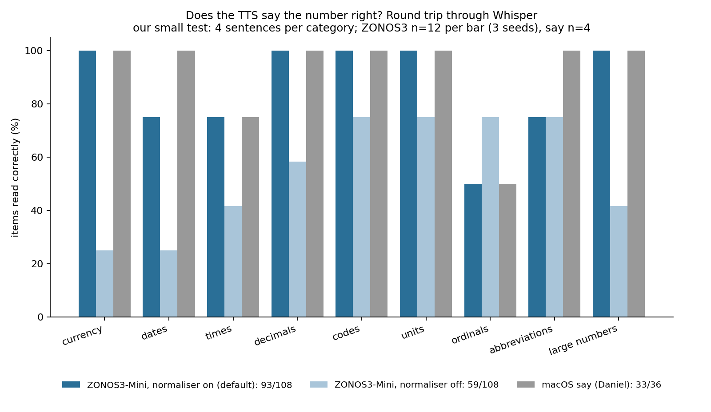

# Does a new 100M-active TTS model read £1,249.50, 07:45 and "approx." correctly?

**What launched (9 Nov 2026):** Zyphra released ZONOS3-Mini, an open text-to-speech model with voice cloning: a
sparse mixture of experts with 800M total and 100M active parameters, Apache 2.0 weights, and runtimes for the
browser (WebGPU), NVIDIA servers (SGLang), C++/ggml and Apple silicon (MLX). The model card lists 43 languages.
Zyphra says it ranks first among open models on their own TTS Capability Index.

- Official: [Zyphra blog](https://www.zyphra.com/our-work/zonos3-mini),
  model [Zyphra/ZONOS3-Mini](https://huggingface.co/Zyphra/ZONOS3-Mini),
  runtimes [github.com/Zyphra/ZONOS3-Mini](https://github.com/Zyphra/ZONOS3-Mini)
- Second source: [AIReiter review, 10 Nov](https://aireiter.com/blog/zonos3-mini-review)

## The question

Voice agents read out prices, booking codes, dates and times all day, and those are the words a listener can't
afford to mishear. ZONOS3-Mini's runtimes put a text normaliser in front of the model (Zyphra's
[zyphra-textnorm](https://github.com/Zyphra/zyphra-textnorm), Rust ports of the NeMo grammars) that turns
"£1,249.50" into "one thousand two hundred and forty nine pounds fifty pence" first. So: how often does the
spoken audio carry the right value, how much of that is the normaliser's work, and where does it go wrong?

## What we did

- 36 English sentences, 4 in each of 9 categories: currency, dates, times, decimals and percentages, codes
  (booking reference, flight, PIN-style code, postcode), units, ordinals and ranges, abbreviations, large numbers
  (`items.py`). All names, codes and figures are made up.
- Three ways to say them:
  - **ZONOS3-Mini with its normaliser on** (the default);
  - **the same model with it off** (`text_normalization: false` per request), so it reads the raw digits itself;
  - **macOS `say`, voice Daniel (en_GB)**, as a familiar baseline.
- ZONOS3-Mini ran locally on the MLX server from Zyphra's repo (commit `96d9e0e`, `backbone-ptq.gguf` with the
  default `zac-keep2` decoder, about 1.2 GB of GGUF files) on an Apple M2, with the BritishFemale stock voice,
  language `en_gb`, default sampling and 3 seeds (1, 2, 3). `say` is deterministic, so it ran once.
  That's 108 clips per ZONOS3 condition and 36 for `say`.
- Every clip was transcribed with Whisper (`mlx-community/whisper-large-v3-turbo` via mlx-whisper 0.4.3,
  temperature 0). An item **passes** only when every key fact in it comes back: the amount, the date, the code.
  Both the transcript and the accepted forms go through Whisper's English text normaliser with spaces removed,
  so "B A 2490" matches "BA2490" (`evaluate.py`).
- `normalised.py` writes what zyphra-textnorm 0.2.0 turns each sentence into (`results/normalised.json`). That
  separates the normaliser's mistakes from the voice model's.

## Results (our small test, not a benchmark)



| Condition | Items with every fact heard | Setup |
|---|---|---|
| ZONOS3-Mini, normaliser on (default) | **93/108** | 36 items x 3 seeds |
| ZONOS3-Mini, normaliser off | **59/108** | 36 items x 3 seeds |
| macOS `say` (Daniel) | **33/36** | 36 items, once |

- **With the normaliser on, every miss came from the normaliser, not the voice.** All 15 misses are the same 5
  sentences failing on all 3 seeds, and each of the 5 is a sentence the normaliser rewrote badly:

  | Written | What the normaliser handed the model | What Whisper heard (all 3 seeds) |
  |---|---|---|
  | The meeting moved to Tue 9 Feb. | ...moved to **Tue** the ninth of february | "moved to **Tew** 9 February" |
  | The run took 2h 15m. | The run took **two H fifteen M**. | "The run took two H15M" |
  | Our ETA is approx. 10 min. | Our ETA is **approx.** ten minutes. | "ETA is **a prox** 10 minutes" |
  | Rooms 101–110 are on the 1st floor. | one hundred and one**–** one hundred and ten | "Rooms 101, 110" (once "100 and 110") |
  | Read chapters 3-7 first. | Read chapters **three-seven** first. | "3-7": no "to" in the spoken form, so we count it as missed |

- **Without the normaliser the model reads digits itself and gets values wrong.** "£1,249.50" came back as
  £1,449.50, £1,049.50 and "£1,449, 50" (0/3 right). "8,945,000 residents" came back as "8,900" or "8,950" on
  every seed. Pi became "3.4459". The postcode "SW1A 1AA" was garbled every time. "€3.2 million" lost the euros
  on all 3 seeds. And 3 of the 108 clips were under 1 second of audio for a full sentence (the model stopped
  almost at once); Whisper then "heard" "Thank you.". Listen: [normaliser on](media/invoice-normaliser-on.mp3),
  [normaliser off](media/invoice-normaliser-off.mp3).
- **Some passes are only passes for a machine.** The normaliser reads codes as amounts: "Enter code 4417" became
  "four thousand four hundred and seventeen", "Flight BA2490" became "BA two thousand four hundred ninety", and
  "18:00" became "eighteen o'clock". Whisper writes all three back as the right digits, so they score as passes,
  but no person reads a PIN or a flight number like that.
- **macOS `say` missed 3/36:** "2h 15m" came back as "2h15 meters", and both ranges (3-7, 101–110) came back with no
  "to", the same two range items ZONOS3-Mini missed.
- Currency, decimals, codes, units and large numbers: 12/12 each for ZONOS3-Mini with the normaliser on.

Per-category counts, early stops and every failed transcript are in `results/summary.json`; every transcript is in
`results/transcripts.jsonl`; the normaliser's output for each sentence is in `results/normalised.json`.

## What it means (and doesn't)

- For a voice agent built on this model, the normaliser is doing most of the work on numbers, and it is plain,
  deterministic text in, text out. That's good news: you can unit-test it without generating any audio, and fix
  your own cases (weekday and unit abbreviations, ranges, "approx.", codes read digit by digit) before the text
  reaches the model.
- Don't turn the normaliser off for numeric content. In our test the model alone misread money and large numbers
  on most seeds.
- This doesn't rate ZONOS3-Mini's voice quality, naturalness or cloning, and it doesn't compare it with other
  open TTS models. A higher pass rate for `say` on 36 items is not "better"; it is a different, rule-based engine.

## What didn't work / limits

- **The listener is a model.** Whisper has a strong language prior and can "repair" audio a person would mishear,
  and it can also hallucinate (it wrote "1A1A1A..." for one garbled postcode clip). The numbers are an upper bound
  on what a human would get right, and nobody listened to all 252 clips.
- Whisper writes British times as "7.45" and "5.30pm". Our first scoring run counted those as misses for every
  condition, `say` included; we added the dot forms to the accepted answers before the final numbers above.
- Ranges are ambiguous in a transcript: "3-7" could be "three to seven" or "three seven". We counted them as
  missed because the normaliser's spoken form has no "to".
- English only, one voice, 36 sentences, 3 seeds. The model card lists 43 languages; we tested none of the
  others.
- `max_tokens` was capped at 400 frames per clip (about 27 s at the codec's 15 frames per second), after an early
  test with the normaliser off ran far past the sentence. No final clip came near the cap (longest 8.7 s).
- Generation and transcription were run as two separate passes, because swapping the GPU between the two MLX
  models made every call slow.

## Reproduce

```bash
# 1. ZONOS3-Mini MLX server (Apple silicon), from Zyphra's repo
git clone https://github.com/Zyphra/ZONOS3-Mini && cd ZONOS3-Mini
git submodule update --init third_party/fusealign-multilingual
uv sync --locked --package zonos3-mlx
hf download Zyphra/ZONOS3-Mini --include 'gguf/backbone-ptq.gguf' 'gguf/zac-keep2.gguf' 'gguf/spk-encoder.gguf' \
    'gguf/steer.gguf' --local-dir servers/ggml
servers/mlx/scripts/serve.sh            # 127.0.0.1:1919

# 2. In this folder
uv run normalised.py                    # what the normaliser makes of each sentence
uv run run.py                           # 252 clips + Whisper transcripts; resumes if cut off
uv run evaluate.py                      # results/summary.json, media/categories.png
```

Needs [uv](https://docs.astral.sh/uv/), ffmpeg and an Apple-silicon Mac. Whisper large-v3-turbo downloads about
1.5 GB on first use. The audio clips (73 MB) are not committed; two samples are in `media/`.
