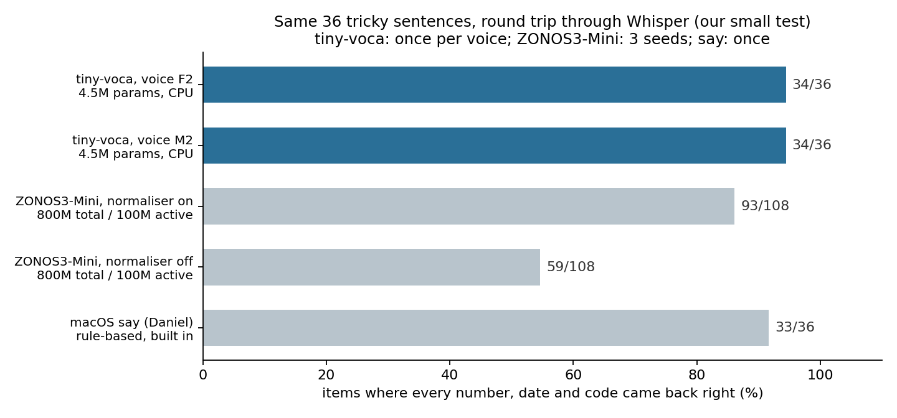

# A 4.5M-parameter TTS model on the same price-and-date test: 34/36

**What launched (14 Nov 2026):** Muhammed Nazeem (n4ze3m) released tiny-voca, an English text-to-speech model with
two voices and 4,537,291 parameters (18 MB), trained from scratch on about 18 hours of synthetic speech. It makes
the waveform with a source-filter synthesiser instead of a neural vocoder, runs on a CPU or in the browser, and
ships code, weights, dataset and training recipe under Apache 2.0 (CC BY 4.0 for the data). Its text goes through
dizione, the author's own rule-based front end, before the model sees it.

- Official: model [n4ze3m/tiny-voca](https://huggingface.co/n4ze3m/tiny-voca), code
  [github.com/n4ze3m/tiny-voca](https://github.com/n4ze3m/tiny-voca), front end
  [github.com/n4ze3m/dizione](https://github.com/n4ze3m/dizione)
- Second source: [Digg AI, 15 Nov](https://digg.com/ai/z4bnw15r)

## The question

Last night we ran Zyphra's new ZONOS3-Mini (800M total, 100M active parameters) through 36 sentences full of
prices, dates, times, codes and units ([2026-11-16-tts-number-reading](../2026-11-16-tts-number-reading/)), and
every miss came from its text normaliser, not the voice. tiny-voca is about 20 times smaller than ZONOS3-Mini's
*active* part. Does a model that small still say "£1,249.50" and "BA2490" right, and where does it go wrong?

## What we did

- The same 36 made-up sentences, 4 in each of 9 categories (`items.py`, copied unchanged).
- tiny-voca from the author's code (commit `db851f7`) and weights (Hugging Face revision `d94d2a0`), through its own
  `speak_text` with the dizione front end it was trained with (commit `8cd889e`), on the CPU of an Apple M2,
  4 threads. Both voices, F2 and M2.
- The model card says the same text gets the same delivery every time. We checked: item 0 spoken twice gave
  identical samples (`results/run.json`). So each voice read each item once: 36 clips per voice.
- Every clip was transcribed with the same Whisper model and settings as last night
  (`mlx-community/whisper-large-v3-turbo` via mlx-whisper 0.4.3, temperature 0) and scored with the same rule: an
  item passes only when every key fact (the amount, the date, the code) comes back (`evaluate.py`).
- The ZONOS3-Mini and macOS `say` numbers are last night's transcripts, re-scored here, not re-run.
- `words.py` writes what dizione turns each sentence into (`results/words.json`), so front-end mistakes can be
  told apart from the model's. `speed.py` times all 36 items per voice.

## Results (our small test, not a benchmark)



| Condition | Items with every fact heard | Setup |
|---|---|---|
| tiny-voca, voice F2 | **34/36** | 36 items, once (deterministic), CPU |
| tiny-voca, voice M2 | **34/36** | 36 items, once (deterministic), CPU |
| ZONOS3-Mini, normaliser on (16 Nov) | 93/108 | 36 items x 3 seeds, MLX |
| ZONOS3-Mini, normaliser off (16 Nov) | 59/108 | 36 items x 3 seeds, MLX |
| macOS `say`, Daniel (16 Nov) | 33/36 | 36 items, once |

- **Both voices missed the same 2 sentences, and both misses were written by the front end, not the model.**

  | Written | What dizione handed the model | What Whisper heard (both voices) |
  |---|---|---|
  | The meeting moved to Tue 9 Feb. | ...moved to **tue** the ninth of february | "moved to **2** the 9th of February" |
  | The run took 2h 15m. | the run took two hours fifteen **meters** | "The run took 2 hours 15 **meters**" |

  dizione does expand "Tue" on its own ("on Tue." becomes "on tuesday") but not right before a date, and it reads
  the "m" in "2h 15m" as metres. ZONOS3-Mini's normaliser tripped on exactly the same two strings last night. (zyphra-textnorm
  0.3.1 has since fixed "Tue"; "2h 15m" is still open there as
  [zyphra-textnorm #1](https://github.com/Zyphra/zyphra-textnorm/issues/1)).
- **The things that tripped ZONOS3-Mini's normaliser went through here.** dizione wrote "101–110" and "3-7" with a
  "to", expanded "approx." to "approximately", and read codes digit by digit ("code 4417" as "four four one seven",
  "BA2490" as "B A two four nine zero") where ZONOS3-Mini's normaliser said "four thousand four hundred and
  seventeen".
- Currency, decimals, codes, units, ordinals, abbreviations and large numbers: 4/4 each, for both voices.
- **Speed (our machine):** 108.5 s of audio in 2.4 s for F2, 99.0 s in 2.33 s for M2, so about 42 to 45 times
  faster than real time on 4 CPU threads of an Apple M2, including the front end (`results/speed.json`). The
  author quotes about 70 times on their machine; we didn't test theirs.

Every transcript is in `results/transcripts.jsonl`, the per-category counts and both failures in
`results/summary.json`, the front end's words in `results/words.json`. Listen:
[the invoice sentence](media/00-tiny-voca-F2.mp3), ["2h 15m"](media/11-tiny-voca-F2.mp3).

## What it means (and doesn't)

- For numbers, the step that writes them out as words decided the result in both models we tried, not the size of
  the model. Think of writing a cheque: the amount is spelled out in words before anyone reads it aloud, and if the
  words are wrong, a perfect reader still says the wrong amount. A 4.5M-parameter model with a careful rulebook got
  the same pass rate on this set as a model 20 times bigger with a different rulebook.
- That rulebook is plain text in, text out. You can test it with your own prices, codes and abbreviations in
  milliseconds, without making any audio (`uv run words.py`).
- It does **not** mean tiny-voca is a better voice than ZONOS3-Mini. 34/36 vs 93/108 is a difference of about 2
  items on a 36-item set, the two front ends handle different cases, and this test says nothing about how natural
  either one sounds. To our ears tiny-voca sounds clearly synthetic, as its own card says.

## What didn't work / limits

- **The listener is a model.** Whisper has a strong language prior and can "repair" audio a person would mishear;
  these numbers are an upper bound on what a person would get right, and nobody listened to all 72 clips.
- **Whisper hides some front-end choices.** "VAT" was read as the word "vat" and "18:00" as "eighteen hundred";
  Whisper wrote both back as "VAT" and "1800", so both pass. dizione reads dates month first by default:
  "14/02/2027" came out right only because 14 can't be a month; "03/04/2027" becomes "march fourth" (front end
  only, not in the 36 items), which is 3 April in the UK.
- English only (the model is English only), 36 sentences, two voices, one run each because the output is fixed.
- The comparison rows are from a different run and a different runtime (ZONOS3-Mini on the GPU via MLX). Only
  the items, the Whisper model and the scoring are shared.

## Reproduce

```bash
uv sync
uv run hf download n4ze3m/tiny-voca --revision d94d2a0338fd1e0eab7dd896ec0ad23d8cdf7c14 --local-dir weights
uv run words.py      # what the front end makes of each sentence
uv run run.py        # 72 clips + Whisper transcripts; resumes if cut off
uv run evaluate.py   # results/summary.json, media/overall.png (reads ../2026-11-16-tts-number-reading)
uv run speed.py      # real-time factor on your CPU
```

Needs [uv](https://docs.astral.sh/uv/) and an Apple-silicon Mac for mlx-whisper (tiny-voca itself runs on any CPU).
Whisper large-v3-turbo downloads about 1.5 GB on first use. The 72 clips are not committed; two samples are in
`media/`.
