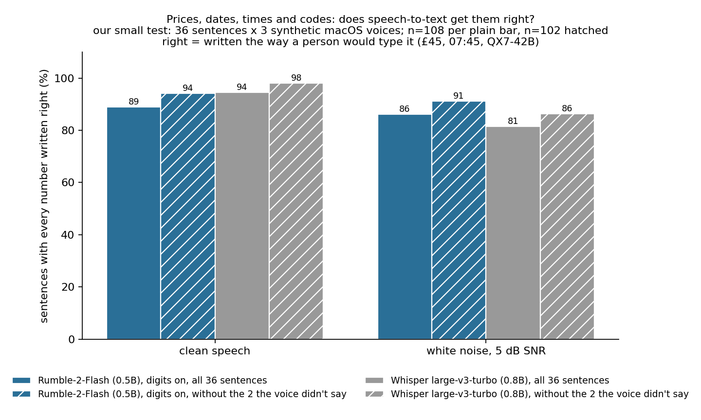

# Does a 0.5B speech-to-text model write £45, 07:45 and QX7-42B the way a person would? (2026-11-19)

**Launch.** Reson8 [Rumble-2-Flash](https://huggingface.co/Reson8/Rumble-2-Flash): an open speech-recognition model
(0.5B parameters, Qwen3-ASR based, 45 languages, Apache 2.0, runs in Hugging Face Transformers and vLLM). Its model
card was updated on 18 Nov 2026 with Open ASR Leaderboard v1.16.1 results (English average WER 6.60, their
number). It has a `digits` option: on (the default) writes "£1,249.50", off writes "one thousand two hundred and
forty nine pounds and fifty pence". Second source: [Artificial Analysis](https://artificialanalysis.ai/speech-to-text/models/reson8).

**Why this test.** On 16 and 17 Nov this lab checked whether new voice models *say* prices, dates and codes right.
This is the other half of a voice pipeline: does the transcriber *write* them right? A word error rate doesn't
tell you that. "£45" and "45 pounds" are one word apart, and "chapters 3-7" against "chapter 37" is a single
character.

## What we tried

- The same 36 made-up sentences as the 16 Nov test (prices, dates, times, decimals, codes, units, ordinals,
  abbreviations, large numbers), spoken by three macOS `say` voices: Daniel (en_GB), Samantha (en_US) and
  Karen (en_AU). That gives 108 clean clips, plus a copy of each with white noise at 5 dB SNR (seeded).
- Three transcribers on every clip: Rumble-2-Flash with digits on, Rumble-2-Flash with digits off, and Whisper
  large-v3-turbo (0.8B, via mlx-whisper) as the familiar baseline. Greedy / temperature 0, one run each.
- **Written score** (the chart): a sentence passes only if every key value appears in the raw transcript in a
  form a person would type ("£45", "7:45", "QX7-42B", "2.4 GB"). Case, spaces, thousands commas and full stops
  are ignored; decimal points are not. Written forms: `items.py` plus `OVERRIDES` in `evaluate.py`.
- **Meaning score** (summary.json only): the lenient 16 Nov rule through Whisper's English normaliser. It turned
  out too lenient for this test, because the normaliser drops hyphens, so "chapter 37" passes for "3-7".

## Results (our small test, not a benchmark)



| | clean (n=108) | 5 dB noise (n=108) | without the 2 unspoken sentences, clean / noise (n=102) | seconds per clip |
|---|---|---|---|---|
| Rumble-2-Flash, digits on | 96 | 93 | 96 / 93 | 0.23 |
| Whisper large-v3-turbo | 102 | 88 | 100 / 88 | 1.2 |

Sentences with every value written right. Setup: Apple M2; Rumble in transformers 5.23.0 / torch 2.15.0 on MPS,
fp16; Whisper in mlx-whisper 0.4.3. The two use different runtimes, so the speed column compares *these setups
on this laptop*, not the models.

1. **A tie, within a handful of sentences.** Whisper was 6 sentences ahead on clean speech and Rumble 5 ahead in
   noise. With 108 sentences from three synthetic voices, neither gap says one model is better.
2. **Two of the 36 sentences can't be passed, and the digits-off mode showed us why.** With digits off, Rumble
   writes down exactly what it heard. For every voice that was "chapters three seven" and "a ratio of three, one":
   macOS `say` evidently never spoke the "to", since Whisper heard the same. No transcriber can restore a separator nobody said. In noise, both models
   wrote "chapter 37" (Rumble 3 of 3 voices, Whisper 2 of 3). On clean speech Whisper guessed "3-7" from
   "chapters" twice; Rumble wrote "3, 7".
3. **The real errors were small and specific.**
   - Rumble wrote "QX7 negative 42B" for the Samantha voice's booking code (clean and noisy), where Whisper
     wrote QX7-42B.
   - In noise Rumble wrote "15,750" as "1,5750" (2 of 3 voices).
   - Whisper wrote "45 pounds" instead of "£45" for the Karen voice. Rumble wrote "£45".
   - Both wrote "45 British pounds" for Samantha, which is what that voice says for "£".
   - In noise both misheard "BA2490" (as "VA", "VH", "80,490") and "API" (as "APR").

Every failure, with what was heard: `results/summary.json`. Every transcript: `results/transcripts.jsonl`.

## What didn't work

- Synthetic voices are clean and regular; real callers aren't. These are upper bounds.
- The meaning score was abandoned for the chart (see above), and Rumble with digits off has no fair score here.
  Most of its "misses" were our normaliser failing to turn "dash" or "fifty pence" back into digits. Its
  transcripts are kept as the record of what each voice actually said.
- White noise is an easy kind of noise; babble, music and phone codecs are harder and weren't tested.

## Reproduce

```bash
uv run run.py        # makes 216 clips with macOS say + ffmpeg, downloads Rumble-2-Flash (1.4 GB), transcribes
uv run evaluate.py   # writes results/summary.json and media/written.png
```

macOS only (the voices come from `say`; Whisper runs on MLX). All sentences, names and codes are made up.
