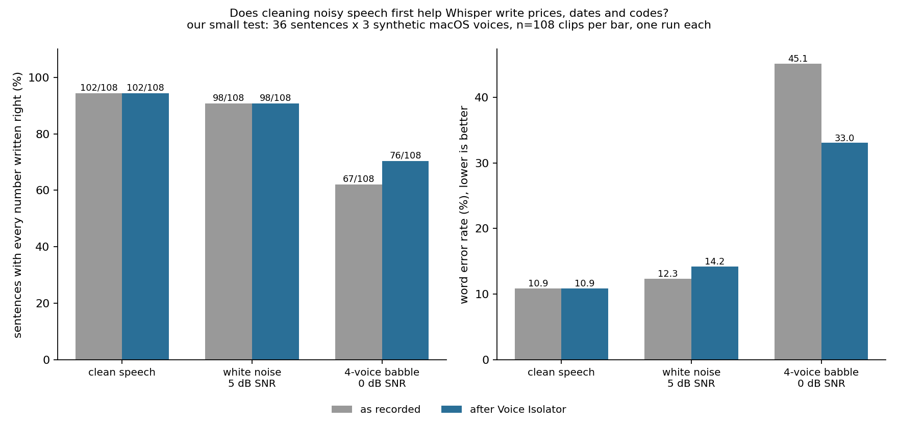

# Does cleaning noisy speech first help Whisper write £45, 07:45 and QX7-42B? (2026-11-20)

**Launch.** Inworld [Voice Isolator](https://inworld.ai/blog/introducing-voice-isolator) (18 Nov 2026): Inworld's
first open model, a 48 kHz speech denoiser, Apache 2.0, code and weights public
([model card](https://huggingface.co/inworld/voice-isolator), `pip install inworld-voice-isolation`). Two
checkpoints: offline (64M parameters) and realtime (58M, 20 ms look-ahead). Second source:
[explainx.ai, 19 Nov](https://explainx.ai/blog/inworld-voice-isolator-open-apache-48khz-realtime-64m-parameters-2026).

**Why this test.** Inworld says the model only denoises, on purpose, "so that it introduces no bias into downstream
training tasks or into realtime speech-to-text models, which can be sensitive to changes in the waveform." They give
no speech-to-text numbers. Our 19 Nov test ended with "white noise is easy; babble wasn't tested." So: put a denoiser
in front of Whisper and check whether prices, dates and codes come out right more often, less often, or the same.

## What we tried

- The same 36 made-up sentences as the 16 and 19 Nov tests (prices, dates, times, decimals, codes, units,
  ordinals, abbreviations), spoken by three macOS `say` voices (Daniel en_GB, Samantha en_US, Karen en_AU) and
  written at 48 kHz: 108 clips.
- Each clip three ways: clean; white noise at 5 dB SNR (seeded); and **babble at 0 dB SNR**: four other macOS
  voices (Moira, Fred, Aman, Kathy) reading four other sentences from the list at the same time. A made-up crowd,
  so no real person's voice is used.
- Every clip transcribed twice by Whisper large-v3-turbo (mlx-whisper, temperature 0): as recorded, and after the
  offline Voice Isolator. 648 transcripts.
- **Written score**: the 19 Nov rule. A sentence passes only if every value appears the way a person would type it
  ("£45", "7:45", "QX7-42B"). **Word error rate**: jiwer, after Whisper's English normaliser on both sides.

## Results (our small test, not a benchmark)



| | written right, as recorded | written right, after isolation | fixed / broken by isolation | word error rate, as recorded → after |
|---|---|---|---|---|
| clean (n=108) | 102 | 102 | 0 / 0 | 10.9% → 10.9% |
| white noise, 5 dB (n=108) | 98 | 98 | 3 / 3 | 12.3% → 14.2% |
| 4-voice babble, 0 dB (n=108) | 67 | 76 | 17 / 8 | 45.1% → 33.0% |

Setup: Apple M2; inworld-voice-isolation 1.0.0, torch 2.15.0 on MPS, fp32; Whisper large-v3-turbo via mlx-whisper
0.4.3; one run each. "Fixed" = the same clip passes only after isolation; "broken" = it passes only before.

1. **On clean speech it really did nothing.** 107 of 108 transcripts came out word for word the same; the one
   change was "SW1A. 1AA" becoming "SW1A1AA". That fits Inworld's "no bias" claim, at least for Whisper.
2. **In babble it helped, mostly by keeping the crowd out of the transcript.** 17 sentences fixed, 8 broken, net
   +9 of 108. Word error rate fell from 45% to 33%, and inserted words almost halved (91 → 49): before isolation
   Whisper often wrote down the crowd ("The site is 5269 Air Force in the United States" for "The year 1066
   changed England"); after, it wrote the sentence.
3. **But it isn't free: some numbers changed.** Among the 8 broken babble clips, after isolation Whisper wrote
   "190 degrees" for 180°C, "2.0 GB" for 2.4 GB and "200th" for "out of 300". A cleaner transcript overall can
   still hold a wrong number, so a pipeline that acts on numbers still needs a check.
4. **White noise: a draw on numbers, slightly worse on words.** 98 = 98 written right (3 fixed, 3 broken), word
   error rate 12.3% → 14.2%, mostly extra substitutions ("VAT" → "BAT").
5. **Speed:** isolation ran at 0.72 s per second of audio on the M2 (1,024 s of audio), Whisper at 1.4 s per clip.
   Our setup, not a tuned one (fp32, offline model, no batching).

Every changed transcript, with both versions: `results/summary.json`. Every transcript: `results/transcripts.jsonl`.

## What didn't work, and the limits

- Synthetic voices, and synthetic babble made of other synthetic voices. Real rooms, phones and accents are
  harder. These numbers are what this set did, not what a call centre will see.
- The isolator keeps the loudest voice. In our babble each crowd voice is about 6 dB quieter than the speaker, so
  this is the friendly case. Inworld says it is not a speaker selector: two people at the same level is a
  different problem.
- **White noise here isn't the same as on 19 Nov.** The clips are 48 kHz now, so the noise is spread up to 24 kHz
  and Whisper (16 kHz) throws two-thirds of it away. That is why Whisper scored 98/108 here and 88/108 on 19 Nov
  at the "same" 5 dB. Babble sits in the speech band, so its 0 dB is closer to what Whisper hears.
- Word error rate on clean speech is 10.9% because the normaliser doesn't turn every symbol back into words the
  same way on both sides ("£1,249.50", "3:1"). It's the same for both columns, so compare across a row only.
- One transcriber (Whisper), one run, one isolator setting. The realtime model wasn't tested.

## Reproduce

```bash
uv run run.py        # makes 324 clips with macOS say + ffmpeg, cleans each with Voice Isolator (256 MB weights), transcribes 648
uv run evaluate.py   # writes results/summary.json and media/isolation.png
```

macOS only (voices from `say`, Whisper on MLX). About 35 minutes on an M2. All sentences, names and codes are made
up.
