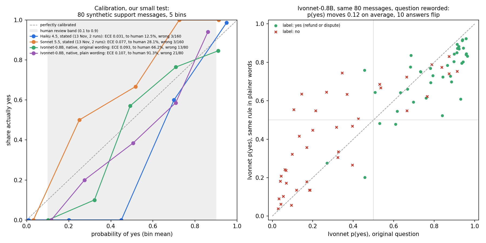

# A free 0.8B decision model on a laptop: are its probabilities safe to act on? (23 Nov 2026)

## What launched
Illuin Technology released two open **decision models** on 23 Nov 2026: **IVE-4B** (on Qwen3.5-4B) and
**Ivonnet-0.8B** (Qwen3.5-0.8B, distilled from IVE-4B), both Apache 2.0.

- **What they do:** you give the model a text (or images) and a question, either multiple choice or yes/no. It returns
  one probability per option in a single forward pass. It writes no text.
- **What Illuin claims:** IVE-4B ranks first of 166 models up to 5B on the Decision Index's private new-domain tasks.
  For Ivonnet-0.8B, the card claims a 2.3% expected calibration error (ECE), the 4th lowest of 73 models up to 1B.
  The card lists CUDA as a requirement and gives 38 ms per text question on one GPU.
- **Sources:**
  - Official: [Hugging Face blog, "Meet IVE, the handyman of your document pipeline"](https://huggingface.co/blog/QuentinJG/ive-release)
    and the [Ivonnet-0.8B model card](https://huggingface.co/illuin/Ivonnet-0.8B)
  - Independent: [123456.ai, open-source item of 23 Nov 2026](https://123456.ai/en/)

## What I tried
On 13 Nov I built a small harness for the Gemini Decisions API (`../2026-11-13-decision-calibration/`). It has:
- 80 synthetic messages to a made-up payments app's support desk;
- one yes/no question ("is the customer asking for money back or contesting a charge?");
- calibration metrics;
- an auto-decide band: act alone when p ≤ 0.1 or p ≥ 0.9, otherwise a person looks.

The Gemini run never happened because there is no key on this machine. Ivonnet-0.8B is the first native
decision model the harness has run on. Tonight I tried three things:

1. **It runs on a Mac with no NVIDIA GPU.** I used the `decision_model` package that ships inside the model repo, on
   an Apple M2 CPU in float32, with no custom kernels.
2. **The same 80 messages and the same question,** run twice to check the output is deterministic. It is scored
   next to the 13 Nov Claude baseline: Haiku 4.5 and Sonnet 5.5, each asked to *write* a probability, 2 runs each.
3. **The same rule in plainer words.** A decision model reads the question, so wording is part of the input. I asked
   "Does this customer want money returned to them, or say a payment on their account is wrong?" and compared.

The labels and the label rule are unchanged from 13 Nov ([data/LABELS.md](data/LABELS.md)). There are 40 yes and
40 no, and 40 of the 80 messages are deliberately hard.

## Results (our small test: 80 synthetic messages, one Apple M2, CPU)



| | Haiku 4.5, stated (13 Nov) | Sonnet 5.5, stated (13 Nov) | Ivonnet-0.8B, original question | Ivonnet-0.8B, plainer question |
|---|---|---|---|---|
| Right at 0.5 | 157/160 (2 runs) | 157/160 (2 runs) | 67/80 | 59/80 |
| Right on the 40 hard messages | 77/80 (2 runs) | 77/80 (2 runs) | 28/40 | 24/40 |
| Brier score | 0.017 | 0.023 | 0.126 | 0.169 |
| ECE, 5 bins | 0.031 | 0.077 | 0.093 | 0.107 |
| Sent to a person by the 0.1–0.9 band | 12.5% | 28.1% | 66.2% (53/80) | 91.3% (73/80) |
| Wrong answers inside the auto-decide band | 0 of 140 | 0 of 115 | 1 of 27 | 0 of 7 |
| Distinct probability values | 17 | 29 | 50 | 52 |
| Change between two identical runs | mean 0.035, max 0.65 | mean 0.011, max 0.15 | 0 (bit-identical) | – |

What I read from it, with only 80 messages:

- **It runs on a laptop, slowly but fine for a queue.** The median was 1.9–2.1 s per message on 4 M2 CPU cores in
  float32 (torch's default of 4 threads; 3 passes of 80). That is about 50x slower than the card's GPU figure, because the Gated DeltaNet layers
  fall back to plain PyTorch without `flash-linear-attention`, which needs Triton and CUDA. The process
  held about 2 GB of resident memory when sampled mid-run. It needed `torchvision`, which the package's `pyproject.toml` doesn't list (see "What didn't work").
- **The probabilities are smooth and repeatable.** There were 50 distinct values against 17 for Haiku's
  written-out numbers, so a threshold can be set finely. Two runs gave bit-identical numbers; Haiku moved 0.80 →
  0.15 on one message between runs on 13 Nov.
- **It is much less accurate on the trap messages.** 10 of its 13 misses are "no" messages that contain money words:
  - "I'd like to send money back to a friend who paid me by mistake" (0.91);
  - "Can you explain what a chargeback is?" (0.79);
  - "When will the refund you approved yesterday show in my account?" (0.87).

  That pattern looks like matching on keywords rather than reading intent. The model is 0.8B, set against two much
  larger chat models, so this is not a fair head-to-head. It shows what a free local model gives you on a task it
  never saw.
- **The band still made it fairly safe, at a cost.** With the 0.1–0.9 band, it decided 27 of 80 messages alone and
  got 26 right. The one miss was the "send money back to a friend" message at 0.913. Two thirds of the messages went
  to a person.
- **The wording moved it more than a second run moved Claude.** Plainer words for the same rule shifted p(yes) by
  0.12 on average and up to 0.49. That flipped 10 answers, mostly "no" messages pushed above 0.5, such as "Can I set
  up a standing order for rent?" (0.34 → 0.75). Right answers fell to 59/80 and the band sent 91% to a person. With
  a decision model, the question text is part of the model: freeze it and test it like code.
- **The card's 2.3% ECE didn't carry over to this task.** We got 0.093 here (5 bins, 80 items, so it is noisy). The
  card's number comes from the Decision Index tasks; ours is one new, trap-heavy question.

None of this says Ivonnet is good or bad in general: one task, 80 items written by one person, and a 0.8B model.

## Reproduce
```
uv run score_ivonnet.py      # downloads illuin/Ivonnet-0.8B (1.7 GB) into weights/; 3 passes of 80 on CPU, ~8 min
uv run evaluate.py           # results/summary.json + media/calibration-and-wording.png
```
`score_ivonnet.py --device mps` tries the Apple GPU instead (not used for the numbers above). The raw probabilities
are in `results/` and the 13 Nov Claude runs are copied into `baseline/`, so `evaluate.py` reproduces the table
without the model. The model commit used is in each results file (`illuin/Ivonnet-0.8B@6a6a979`).

## What didn't work / limits
- **Missing dependency:** `pip install -e source/` isn't enough. `AutoProcessor` loads the Qwen3-VL video processor,
  which raises `ImportError: ... requires the Torchvision library`. Adding `torchvision==0.26.0` fixed it.
- **CPU only, float32,** with no `flash-linear-attention` (the card's recommended kernels are CUDA-only), so speed
  here says nothing about GPU speed. The answers should match the reference implementation; transformers itself
  says the fallback is "correct but much slower". I didn't compare against a GPU run.
- **IVE-4B (9.1 GB) doesn't fit** this Mac's 8 GB of RAM, so the bigger model the card leads with is untested.
- **The dataset:** 80 synthetic items, written and labelled by one person, with a 50% base rate and half of the items
  deliberately hard. Real inboxes look different.
- **Two different methods:** the Claude numbers are probabilities the model wrote out in batches of 20 (13 Nov), and
  Ivonnet's are native probabilities, one message at a time. The comparison shows what each method gives you, not
  which model is smarter.
- **Two wordings only.** One rewording is enough to show the effect exists, not to measure how big it usually is.
