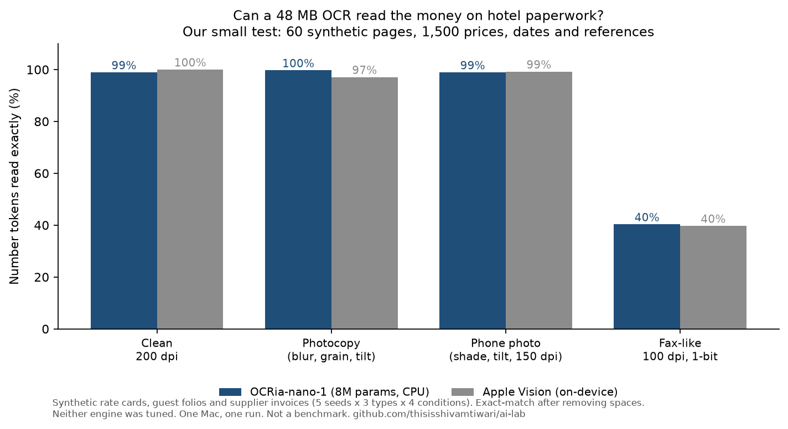

# Can a 48 MB OCR read the money on hotel paperwork? OCRia-nano-1 vs Apple Vision (25 Nov 2026)

## What launched
LlamaIndex released **OCRia-nano-1** on 23 Nov 2026: an 8.1M-parameter document-parsing pipeline (a line detector,
four script recognisers and a small layout/table model) distilled from its 4B OCRia-1 model. It is 48 MB of ONNX
files, runs on a CPU through the open-source LiteParse tool (`pip install liteparse`), and in WebAssembly in a
browser. The card claims 59.2 on ParseBench-2 against 48.7 for Tesseract and 426 ms a page on one core.

- Official: https://www.llamaindex.ai/blog/introducing-ocria-nano-1
- Second source (model card, files and licence): https://huggingface.co/llamaindex/OCRia-nano-1

Licence note: the weights are under an Open RAIL-M-based "OCRia-nano-1 Model License" (free for research and for
companies under $2M revenue; a commercial licence for bigger ones and for competing OCR products). LiteParse itself
is Apache 2.0. Check the LICENSE file yourself before relying on it.

## What we tried
Hotels run on paper that carries numbers: rate cards, guest folios, supplier invoices. A single wrong digit on a
folio is a chargeback; a wrong one on an invoice is a payment dispute. Vendor benchmarks score whole-page text, so
we scored only the **number tokens**: every price, date, booking or invoice reference, percentage, quantity, card
digits and bank details on the page.

- **Pages:** 60 synthetic pages = 3 document types (rate card, guest folio, supplier invoice) x 5 random seeds x 4
  image conditions. Hotel names, items and amounts are made up by `generate.py`; no real hotel, guest or client data.
- **Conditions:** clean (A4 at 200 dpi); photocopy (0.9 px blur, grain, up to 1.2° tilt, grey tint); phone photo
  (a lighting gradient, lower contrast, 1.1 px blur, up to 2.5° tilt, 150 dpi); fax-like (100 dpi, 1-bit threshold).
- **Engines, both untuned, default settings:** OCRia-nano-1 through LiteParse 2.21.2 (`lit parse --format text`,
  ONNX Runtime 1.31.1, CPU); Apple Vision `VNRecognizeTextRequest` on the same Mac (the on-device OCR helper from
  our demo pipeline; it reported the "accurate" model on all 60 pages tonight).
- **Score:** a token counts as read if it appears exactly in the output after removing spaces (both engines space
  text differently). "Near-miss amounts" are amount-shaped strings in the output that match no true amount on the
  page: the dangerous case, because they look right.
- **Machine:** Apple M2, 8 GB, one run each. Timing is wall-clock per page including process start.

Reproduce: `./run.sh` (needs `uv` and macOS for the Vision helper; the OCRia part runs anywhere LiteParse does).

## Results (our small test, not a benchmark)

Number tokens read exactly, 375 per condition (1,500 total):

| Condition | OCRia-nano-1 | Apple Vision |
|---|---|---|
| Clean, 200 dpi | 371/375 (98.9%) | 375/375 (100%) |
| Photocopy | 374/375 (99.7%) | 364/375 (97.1%) |
| Phone photo | 371/375 (98.9%) | 372/375 (99.2%) |
| Fax-like, 100 dpi | 151/375 (40.3%) | 149/375 (39.7%) |
| All 60 pages | 1,267/1,500 (84.5%) | 1,260/1,500 (84.0%) |

Near-miss amounts (amount-shaped output that matches nothing on the page), 15 pages per cell:

| Condition | OCRia-nano-1 | Apple Vision |
|---|---|---|
| Clean | 1 | 0 |
| Photocopy | 0 | 5 |
| Phone photo | 1 | 0 |
| Fax-like | 62 | 70 |

Median time per page: OCRia-nano-1 0.34 s, Apple Vision 0.19 s (both including process start-up).

What we saw:
- **On readable pages the 8M-parameter model is as good as the OS OCR on numbers.** Across the 45 clean, photocopy
  and phone pages, OCRia-nano-1 missed 9 of 1,125 number tokens and Apple Vision missed 14. Every miss was a single
  amount or quantity, e.g. OCRia read one `£188.33` wrongly on a clean rate card, and Vision read `£103.18` and
  `£353.13` as `10318` and `35313` on one photocopy (it dropped the decimal point, which turns £103 into ten thousand).
- **At fax quality both engines fail the same way, and it is the worst way.** Both read about 40% of the tokens, and
  the 60% they lost were almost all amounts (206 of the 300 amounts for each engine; every date survived). Worse,
  the output still contained amount-shaped strings: OCRia-nano-1 produced 62 near-miss amounts and Vision 70, such
  as `£168.94` for `£168.95` and `£399.79` for `£399.29`. A downstream system would take those as real prices.
- **Why the amounts and not the dates:** in our pages the amounts sit in a monospaced column font that is smaller than
  the body text, so at 100 dpi with a hard threshold they fall below what either engine can read. The dates are in
  the larger body font and survived. This is a property of our synthetic pages as much as of the engines.
- **OCRia-nano-1 keeps the table.** Its text output stays column-aligned, which makes the amount next to "TOTAL DUE"
  easy to pick out. Vision returns lines in reading order with no column structure, so pairing an item with its
  amount needs the boxes.
- **Quantity column.** Both engines sometimes dropped single-digit quantities on the folio (the `4`, `1` beside an
  item); our score for those is lenient (a `4` anywhere on the page counts), so this does not show in the table.

## What didn't work
- Apple Vision's "accurate" model, which failed on this Mac on 12 Nov (Neural Engine error), ran on all 60 pages
  tonight. We did not test the "fast" model, which inserts stray spaces.
- Tesseract is not installed on this Mac, so LiteParse's own baseline is not in the comparison.
- The LiteParse Python package's `models.pull` and `LiteParse(...)` API is in the card; we used the `lit` CLI
  because it was simplest to time from the outside.
- We did not test PDFs, multi-page documents, handwriting, or non-Latin scripts. Our pages use one font pair.

## The honest limit
Sixty synthetic pages in one font pair, written by the same script that scores them, on one Mac, one run. The
conditions are our approximations of a photocopy, a phone photo and a fax, not real ones. Any difference between the
two engines on the readable pages (9 vs 14 misses out of 1,125) is within what a different seed could flip. The one
finding we would stand behind: below about 100 dpi, neither engine knows it can't read the number, and both keep
producing plausible wrong amounts.

Files: `generate.py` (pages and truth), `run.py` (both engines, scores), `chart.py` (chart and near-miss analysis),
`out/summary.json`, `out/near_miss.json`, `out/results.json` (every page, every miss, the raw OCR text),
`media/sample-fax-invoice.png` and `media/sample-phone-invoice.png` (two of the input pages).
